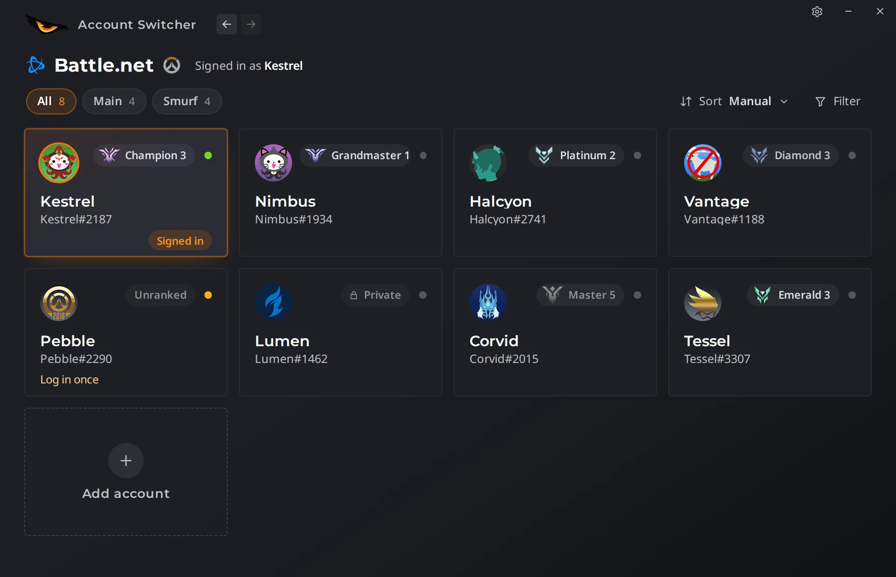
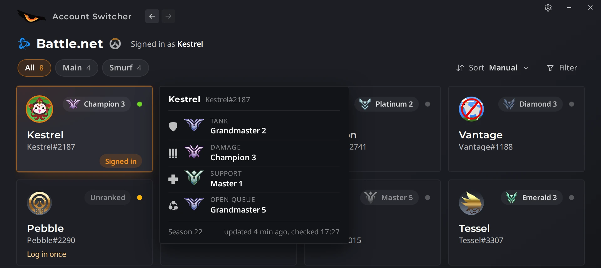
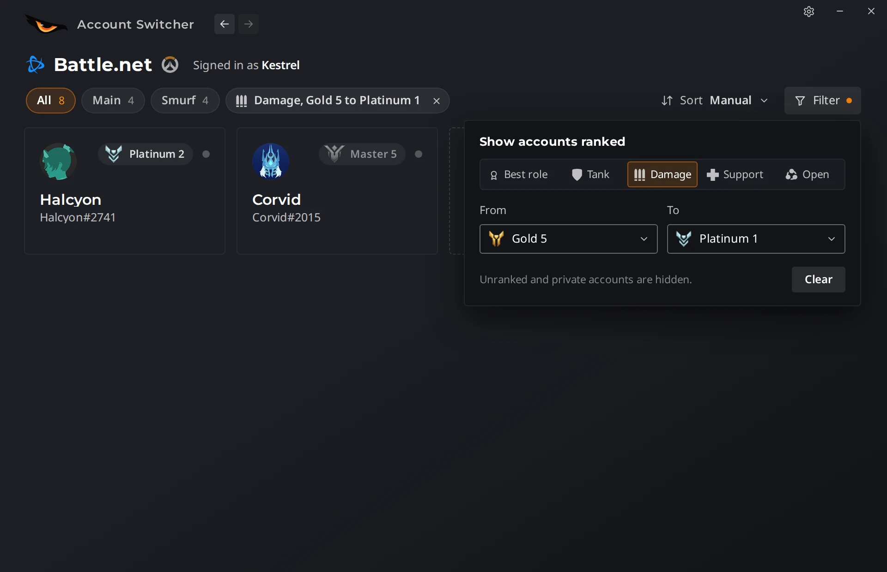
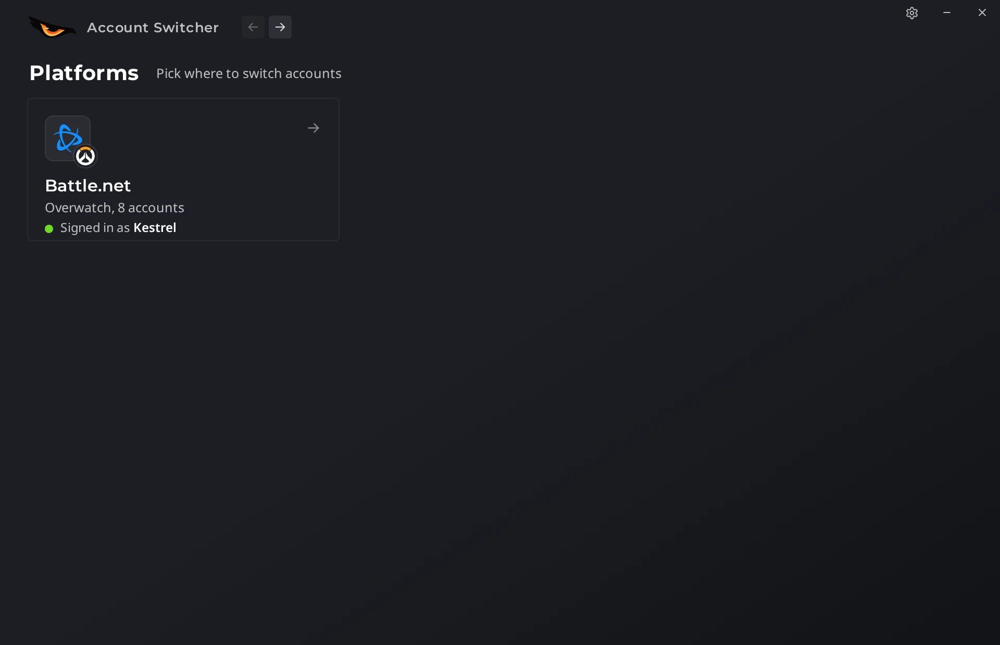
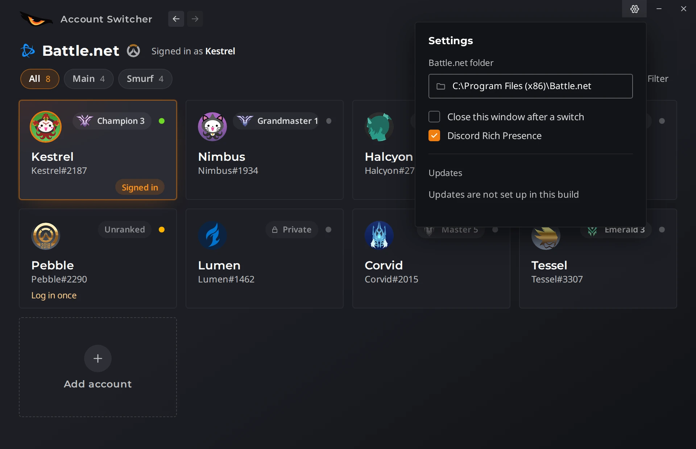

<p align="center">
  
</p>

<h1 align="center">EagleEye Account Switcher</h1>

<p align="center">Switch between your Battle.net accounts in one click, without typing a password.</p>

<p align="center">
  
</p>

Made for Overwatch players who have more than one Battle.net account: a main, a smurf or two, an account for playing
with friends. That is why every account shows its Overwatch rank and player icon, so you can pick the right one for a
lobby at a glance.

> **Looking for the official version?** This repository is the open-source edition. The official EagleEye Account
> Switcher comes through the free [EagleEye launcher](https://games.eagleeye.ro/download): it always has the newest
> version, updates itself, and gets extra features first (for example showing in Discord while it is open). Open the
> launcher's SOFTWARE tab and click Install.

## Features

- **One-click switching.** Double-click an account and Battle.net restarts signed in to it, usually in about 5 seconds.
  No password, no email to type.
- **Add an account once.** Log in to Battle.net one time with "Keep me logged in" ticked, and the account is saved.
- **Overwatch ranks at a glance.** Every card shows its best rank. Hover a card to see Tank, Damage, Support and Open
  Queue for the current season, with the player's own icon.
- **Main and Smurf tabs.** Put each account in a tab and see only the ones you need.
- **Sort and filter by rank.** Highest rank first, or by one role, or only the accounts between two ranks. Cards slide
  smoothly into their new places when the order or the filter changes.
- **Placements and manual ranks.** Mark a role as "in placements" with a predicted rank, or set a rank by hand.
- **Closes the game for you.** If a Blizzard game is running when you switch, it is closed first.
- **Switch from the tray.** The tray icon's menu lists every saved account; pick one to switch without opening the
  window.
- **Import from TcNo.** Already using TcNo Account Switcher? Your Battle.net accounts can be brought over in one go.
- **Platforms.** The back button opens a Platforms page with every platform the switcher handles. Today that is
  Battle.net; the page is built so another platform can be added the same way.
- **An update button, never a forced update.** In a build with updates set up (see
  [Set up your own auto-updates](#set-up-your-own-auto-updates)), an orange "Update to X" button appears next to the
  window buttons when a new version is out. Nothing installs until you click it.

## Screenshots

<p align="center">
  
  <br><em>Hover an account to see its ranks per role.</em>
</p>

<p align="center">
  
  <br><em>Show only the accounts in a rank range, for one role or the best role.</em>
</p>

<p align="center">
  
  <br><em>Back goes to the platforms. Battle.net for now.</em>
</p>

<p align="center">
  
  <br><em>Settings.</em>
</p>

The accounts and BattleTags in these screenshots are made up; the player icons are real Overwatch player icons.

## Download and install

Two ways, both for Windows 10 or 11 with Battle.net installed:

- **Official, recommended:** install it from the SOFTWARE tab of the [EagleEye launcher](https://games.eagleeye.ro/download).
  That version keeps itself up to date and has the most features.
- **Open-source build:** download `EagleEye-Account-Switcher-<version>-setup.exe` from [Releases](../../releases/latest)
  and run it. It is built from this repository as it is, so it does not update itself; check Releases for new
  versions. Windows may show "Windows protected your PC" because the installer is not code-signed: click "More info",
  then "Run anyway".

Or build it yourself in a few minutes; see [Build from source](#build-from-source).

Both versions keep their data in the same place, so you can move from one to the other without adding your accounts
again.

## How it works

When you tick "Keep me logged in", Battle.net stores a login token for that account on your PC. The switcher keeps
its own copy of each account's token, encrypted with Windows' own data protection (DPAPI), so only your Windows user
can read it. To switch, it closes Battle.net, puts the token of the account you picked back in place, and starts
Battle.net again, which then signs in by itself. Tokens are never sent anywhere; they never leave your PC.

If Blizzard ever asks for a password again (for example after a password change), the card says "Log in once". Log
in one time and the account is saved again.

More detail for the curious: [docs/RESEARCH.md](docs/RESEARCH.md).

## Privacy

- Everything the app saves stays on your PC, in `%APPDATA%\EagleEye Account Switcher`. Nothing is uploaded.
- Login tokens and email addresses are encrypted with DPAPI. The app shows emails only in masked form.
- For ranks, the app asks the [OverFast API](https://github.com/TeKrop/overfast-api) for the public Overwatch
  profile of each BattleTag. OverFast is a free, open-source (MIT) third-party service that reads Blizzard's public
  career pages; it is not run by this project. Only the BattleTag is sent. You can point the app at your own OverFast
  instance in `settings.json`.
- Rank icons and player icons are downloaded from Blizzard the first time they are needed and cached in the same
  folder.

## Build from source

You need, on Windows:

- [Node.js](https://nodejs.org/) 20 or newer
- [Rust](https://rustup.rs/) (stable)
- [Microsoft C++ Build Tools](https://visualstudio.microsoft.com/visual-cpp-build-tools/) with "Desktop development
  with C++"
- WebView2, which Windows 10 and 11 already include

Then, in a terminal in the project folder:

```
npm ci
npm run icons
npx tauri build
```

The installer is written to `src-tauri\target\release\bundle\nsis\`. To build only the program without an installer,
use `npx tauri build --no-bundle`; the exe is in `src-tauri\target\release\`.

`npm run icons` is optional: it downloads the Battle.net and Overwatch emblems (Blizzard trademarks, not in this
repository) so the build shows them next to the Battle.net heading. Skip it and the app works the same without them.

No signing key is needed. Auto-updates are switched off in this repository (see below).

### Work on the interface without Windows

The interface runs in any browser with made-up accounts, so you can work on it on any system:

```
npm ci
npm run dev
```

and open `http://localhost:1420`. `npm run icons` downloads the rank icons and the Battle.net and Overwatch emblems
into `temp/` (they are Blizzard artwork and trademarks and are never committed). A build made after `npm run icons`
includes the emblems; without them the app works the same and shows no emblem. The full list of checks is in
[CONTRIBUTING.md](CONTRIBUTING.md).

## Set up your own auto-updates

The app has a built-in updater that is switched off in this repository. When it is off, the app never checks for
updates and Settings says "Updates are not set up in this build". If you publish your own builds, you can turn it on:

1. Create a signing key pair (keep the private key secret and out of the repository):
   ```
   npx tauri signer generate -w %USERPROFILE%\.tauri\account-switcher.key
   ```
2. In `src-tauri/tauri.conf.json`, put the public key in `plugins.updater.pubkey`, your update address in
   `plugins.updater.endpoints` (for example `["https://example.com/account-switcher/latest.json"]`), and set
   `bundle.createUpdaterArtifacts` to `true`.
3. Build with the private key available, so the installer gets a signature:
   ```
   set TAURI_SIGNING_PRIVATE_KEY=%USERPROFILE%\.tauri\account-switcher.key
   set TAURI_SIGNING_PRIVATE_KEY_PASSWORD=<the password you chose, if any>
   npx tauri build
   ```
   Next to the installer you get a `.sig` file.
4. Upload the installer (any file name) and host a `latest.json` at your endpoint:
   ```json
   {
     "version": "1.1.0",
     "notes": "What changed",
     "pub_date": "2026-01-01T00:00:00Z",
     "platforms": {
       "windows-x86_64": {
         "url": "https://example.com/account-switcher/account-switcher-1.1.0-setup.exe",
         "signature": "<contents of the .sig file>"
       }
     }
   }
   ```

The app then checks 5 to 30 seconds after it starts and about every 6 hours, with a little random spread so many
users do not all ask at once. It never asks more than once a minute, backs off after a failed check, and leaves the
server alone for 15 minutes when it answers with an error such as 429. It only shows an orange "Update to X" button
next to the window buttons; nothing is downloaded until the user clicks it or "Update now" in Settings. Details:
[Tauri updater documentation](https://v2.tauri.app/plugin/updater/).

## Contributing

Bug reports, ideas and pull requests are welcome. Start with [CONTRIBUTING.md](CONTRIBUTING.md); the design is
described in [docs/DESIGN.md](docs/DESIGN.md).

## License

[MIT](LICENSE). Third-party parts and their licenses are listed in
[THIRD-PARTY-NOTICES.md](THIRD-PARTY-NOTICES.md).

## Disclaimer

Battle.net and Overwatch are trademarks of Blizzard Entertainment, Inc. This project is not affiliated with or
endorsed by Blizzard Entertainment. It only works with files and settings that Battle.net keeps on your own PC, and
it does not change the game. Use it at your own risk.
